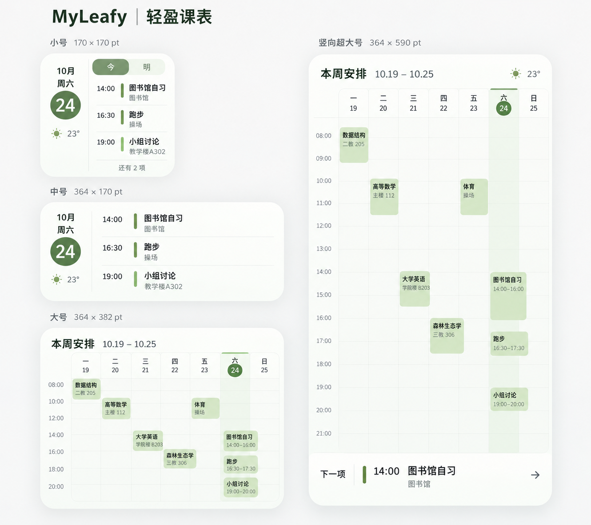

# iOS Widget 视觉升级

采用所有者选定的第三版。按最新真机反馈，仅保留小号、横向中号与 iOS 27+ 竖向超大号，移除普通大号 `systemLarge`；iOS 17–26 可添加小/中号。范围仅限 iOS Widget；课程、个人日程、App Group archive v2、通知与同步协议不变。跟踪 [#45](https://github.com/IsaacHuo/MyLeafy/issues/45)。

## 视觉基准

此图用于确认日期侧栏、紧凑周网格、今日圆形标识和浅色课程块；不是运行截图。图中固定尺寸和晴雨图标不作为产品契约：实际布局使用系统尺寸，天气仅使用有效缓存的温度与真实状态，不根据温度推测晴雨。两种日视图都保留今/明切换；隐藏数量使用真实剩余安排，修正概念图的示意计数。

## 实现

- 小/中号保留按时间排列的混合日安排，日期、星期和温度位于左侧。标题优先，地点按空间显示；行数按实际高度减少。
- 竖向超大号使用 `LeafyWeekWidgetView` 和 `LeafyWidgetWeekBlock.layout`；普通大号的注册、预览及专用显示分支已移除。默认显示周一至周日，真实时间定位、跨天裁切、最多两条冲突轨道及更多入口沿用原行为。
- 超大号只在 iOS 27+ 注册 `systemExtraLargePortrait`；增加网格纵向空间和小时刻度。按真机反馈将底栏从 40pt 压为 18pt 单行，并缩减上下留白、网格表头及分区间距，在同一系统容器内约多出 52pt 给课表主体；底部仍直接打开进行中/下一项安排，全天结束与空状态分别呈现。
- 竖向超大号的课程块优先保留完整教室。地点合并多余空白后优先用 9pt 单行，略超宽时采用 8pt 单行，仍放不下才用 8pt 完整换行；如“二教 703”避免占两行，把高度留给课程名。按实际可用高度从四行课程名逐步减少到仅地点，不隐藏长地点。右上角展示有效观测的温度及天气状态（例如“14° 多云”），缺少状态时只显示温度。
- 继续使用原主题及系统外观。着色/透明模式降低装饰填充，保留文字、分隔线和强调标识，由系统处理材质。最低 iOS 17 不变，编译工具链使用 Xcode 27.1。

## App 天气同步修复

跟踪 [#48](https://github.com/IsaacHuo/MyLeafy/issues/48)。此前 Widget 误读分享图的校园天气缓存，而 App 课表/天气面板写入另一份定位天气缓存；定位天气成功查询后也未通知共享快照更新。现统一读取当前身份的 `timetableWeather.cache.v2`，成功缓存后通过已有通知触发快照重建及 Widget 时间线刷新请求。沿用原始 `observedAt` 与六小时观测有效期，重新保存旧观测不能延长有效期；不新增 Widget 定位、联网或改动缓存格式。

新增回归覆盖实际缓存来源、分享图缓存不能冒充定位天气、旧观测过期与账号隔离，并检查缓存写入后再发出更新通知。本地 Xcode 27.1 arm64 iOS 17 设备目标构建通过（App、Widget、分享扩展，未签名、未运行），包含新增回归的设备测试目标也编译通过；不执行本地 XCTest 或启动 Simulator，远程执行结果以 PR #46 的精确提交为准。系统决定实际桌面时间线刷新时刻。

## 真机反馈后的增量验证

共享 archive v2 的天气对象新增可选 `condition`，旧快照仍能解码；状态和温度共用六小时有效期，未知或缺失状态不猜测，不改变主 App 的定位缓存格式。

本轮新增天气状态兼容/过期和真实共享状态的离线回归用例。任务 Swift 格式检查与 iOS 17 设备目标测试包编译通过（未签名、不执行 XCTest）；天气 DTO 的原生离线探针验证旧/新读取兼容与观测有效期，不替代 Widget 运行截图。基础 CI 结果见关联 PR；继续由所有者真机检查教室、课程密度、底栏和天气，不启动本地 Simulator、不重跑完整基线。

## 验证与验收边界

按所有者最新要求，最终视觉、文字密度和系统桌面交互由真机验收；不再启动或操作本地 Simulator，也不新增截图 CI 流程。

- 本地 App 与测试包的 iOS 17 最低目标构建通过；最终 Widget 的 arm64 iOS 17 设备目标编译也通过（未签名、未运行）。编译不等于签名安装、真机交互或正式发布。
- 18 项定向 XCTest 实际执行通过，覆盖 Widget 时间格式、天气过期及身份清理、教师投影和深链路由。英文文案显式使用所选语言资源，时间统一使用 24 小时制，与周时间轴一致；无结束时间仍只显示真实开始时间。
- 实施期间曾用生产组件生成离线样本图，排除了日期后缀截断、英文文案和下午时间歧义；这些中间图不替代最终真机视觉验收，也不作为发布证据。
- 首次完整 CI 的 iOS 构建通过，但 9 项未修改区域的持久化、CSV 和图片用例失败；本地串行抽查其中 5 项同样失败，见独立问题 [#47](https://github.com/IsaacHuo/MyLeafy/issues/47)。后续审核保留数据恢复检查并修正实现，简化图片逐通道舍入约束，详见上述 Issue 的排查记录；完整 CI 门禁继续保留，不能以定向通过替代。精确当前提交的结果见 [PR #46](https://github.com/IsaacHuo/MyLeafy/pull/46)。
- 未进行签名安装、真机视觉或正式发布。所有者随后要求与 iPhone Duo 自适应一起整合到 main；远程主线仍受必需 CI result 保护，实际集成状态见 CURRENT 与 PR #46。Issue 在真机验收前不标记 Done。
